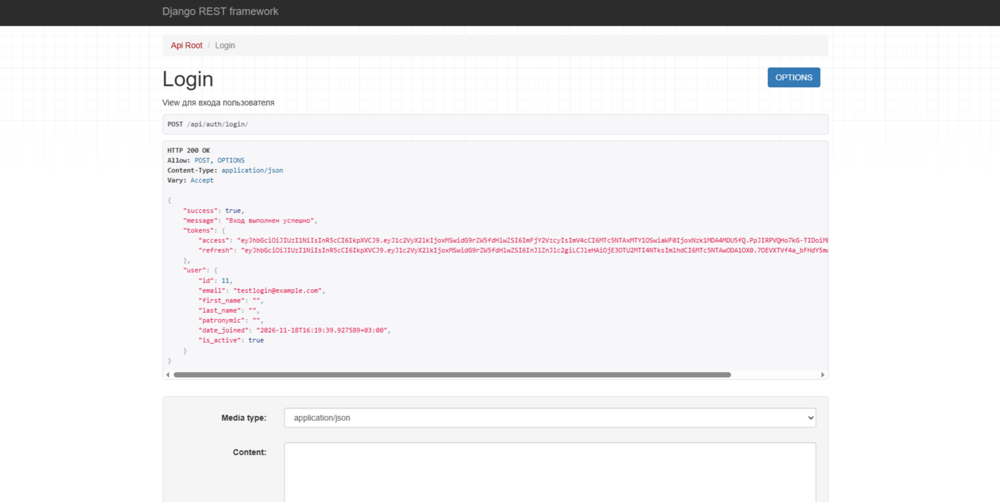
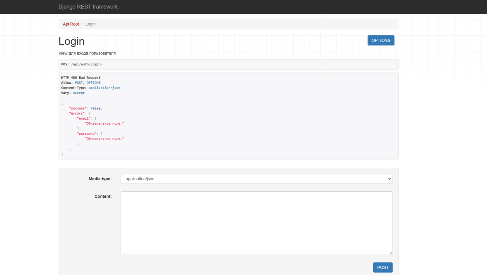

# User Portal - cистема аутентификации и авторизации

Backend-приложение для управления пользователями и разграничения прав доступа. Реализована собственная система аутентификации (JWT) и гибкая система прав (RBAC + ABAC).


## О проекте

Сервис позволяет:
- Регистрироваться, входить и выходить из системы (с использованием JWT).
- Управлять профилем (просмотр, обновление, мягкое удаление).
- Менять пароль.
- Управлять ролями и правами доступа через админ-панель.
- Работать с демо-объектами (посты, комментарии, товары), проверяя права доступа к ним.

## Демонстрация работы

**Успешная аутентификация и получение JWT-токенов:**


**Защита эндпоинтов (запрос без токена):**


## Технологический стек

- **Язык:** Python 3.11
- **Фреймворк:** Django 4.2, Django REST Framework
- **База данных:** SQLite 
- **Аутентификация:** Кастомный JWT (через `PyJWT`)
- **Контейнеризация:** Docker, Docker Compose
- **Тестирование:** Django TestCase (8 тестов)

## Запуск проекта

### Вариант 1: Через Docker

Требуется **Docker Desktop**.

1. Клонируйте репозиторий: 
    ```bash
   git clone https://github.com/Jordany-Rod/Authentication_User.git
   cd User_Portal

2. Создайте файл .env на основе .env.example:
    ```bash
   cp .env.example .env
   
(Заполните SECRET_KEY).

3. Запустите контейнер:
    ```bash
   docker compose up --build

4. Откройте в браузере: http://127.0.0.1:8000/api/auth/login/

### Вариант 2: Локальный запуск

1. Создайте и активируйте виртуальное окружение:
    ```bash
    python -m venv venv
    source venv/bin/activate  # для Linux/macOS
    venv\Scripts\activate     # для Windows
   
2. Установите зависимости:
    ```bash
   pip install -r requirements.txt
   
3. Создайте .env на основе .env.example.
4. Примените миграции и запустите сервер:
    ```bash
    python manage.py migrate
    python manage.py runserver

## Тестирование

В проекте написаны тесты для проверки основной бизнес-логики (аутентификация, права доступа):
```bash
python manage.py test
```
(Все 8 тестов должны завершиться со статусом OK).

### Заполнение тестовыми данными

```bash
# Полная очистка и заполнение
python manage.py seed_all --clear

# Только права
python manage.py seed_permissions

# Только бизнес-объекты
python manage.py seed_business
```

## Тестовые пользователи

| Email | Пароль | Роль |
|-------|--------|------|
|   admin@example.com    |    testpass123    |   Администратор   |
|   manager@example.com    |     testpass123   |   Менеджер   |
|   user1@example.com    |    testpass123    |   Обычный пользователь   |
|   seller1@example.com    |    testpass123    |   Продавец   |

## Примеры запросов

### 1. Регистрация пользователя
```bash
curl -X POST http://127.0.0.1:8000/api/auth/register/ \
  -H "Content-Type: application/json" \
  -d '{
    "email": "user@example.com",
    "first_name": "Иван",
    "last_name": "Иванов",
    "password": "secure123",
    "password2": "secure123"
  }'
```
### Ответ:
```json
{
  "success": true,
  "message": "Пользователь успешно зарегистрирован",
  "user": {
    "id": 1,
    "email": "user@example.com",
    "first_name": "Иван",
    "last_name": "Иванов",
    "is_active": true
  }
}
```
### 2. Вход в систему

```bash
curl -X POST http://127.0.0.1:8000/api/auth/login/ \
  -H "Content-Type: application/json" \
  -d '{
    "email": "user@example.com",
    "password": "secure123"
  }'
```
### Ответ:
```json
{
  "success": true,
  "message": "Вход выполнен успешно",
  "tokens": {
    "access": "eyJhbGciOiJIUzI1NiIsInR5cCI6IkpXVCJ9...",
    "refresh": "eyJhbGciOiJIUzI1NiIsInR5cCI6IkpXVCJ9..."
  }
}
```
### 3. Получение профиля (требуется токен)
```bash
curl -X GET http://127.0.0.1:8000/api/auth/me/ \
  -H "Authorization: Bearer <ваш-токен>"
```

### 4. Создание поста
```bash
curl -X POST http://127.0.0.1:8000/api/business/posts/ \
  -H "Authorization: Bearer <ваш-токен>" \
  -H "Content-Type: application/json" \
  -d '{
    "title": "Мой первый пост",
    "content": "Содержание поста",
    "status": "draft"
  }'
```

## Документация API

### Аутентификация

| Метод | Эндпоинт | Описание |
|-------|----------|----------|
| POST | /api/auth/register/ | Регистрация нового пользователя |
|   POST    |     /api/auth/login/     |     Вход в систему     |
|   POST    |    /api/auth/logout/      |     Выход (добавление токена в черный список)     |
|   POST    |     /api/auth/refresh/     |     Обновление access токена     |
|    POST   |     /api/auth/change-password/     |     Смена пароля     |
|   DELETE    |     /api/auth/delete-account/     |       Мягкое удаление аккаунта   |

### Профиль пользователя

| Метод | Эндпоинт | Описание |
|-------|----------|----------|
|   GET    |     /api/auth/profile/     |      Получение данных профиля    |
|   PUT    |     /api/auth/profile/     |     Обновление профиля     |
|    GET   |     /api/auth/me/     |     Информация о текущем пользователе     |

### Управление правами (только для администраторов)

| Метод | Эндпоинт | Описание |
|-------|----------|----------|
|   CRUD    |     /api/auth/admin/roles/     |     Управление ролями     |
|    CRUD   |    /api/auth/admin/resources/      |     Управление ресурсами     |
|    CRUD   |     /api/auth/admin/actions/     |     Управление действиями     |
|    CRUD   |     /api/auth/admin/permissions/     |     Управление разрешениями     |
|   CRUD    |     /api/auth/admin/user-roles/     |       Назначение ролей пользователям   |
|   GET    |     /api/auth/admin/users/     |     Просмотр пользователей     |

### Демо-объекты (бизнес-логика)

| Метод | Эндпоинт | Описание |
|-------|----------|----------|
|   CRUD    |     /api/business/posts/     |     Управление постами     |
|   CRUD    |     /api/business/comments/     |     Управление комментариями     |
|   CRUD    |     /api/business/products/     |     Управление товарами     |
|    CRUD   |     /api/business/orders/     |      Управление заказами    |
|   CRUD    |     /api/business/categories/     |     Управление категориями     |

## Система прав доступа

Подробное описание системы прав находится в файле PERMISSIONS.md

### Основные принципы
1. RBAC (Role-Based Access Control) - доступ через роли
2. ABAC (Attribute-Based Access Control) - условия на атрибутах
3. Прямые разрешения - override для конкретных пользователей
4. Приоритет запретов - запрет имеет больший приоритет

### Коды ответов
| Код | Описание |
|-----|----------|
|  200   |     Успешный запрос     |
|  201   |     Ресурс создан     |
|   400  |     Ошибка валидации данных     |
|   401  |     Не авторизован (требуется токен)     |
|   403  |      Доступ запрещен (недостаточно прав)    |
|   404  |     Ресурс не найден     |

## Архитектурные особенности
- Кастомная модель пользователя: Авторизация по email.
- JWT-аутентификация: Access и Refresh токены. Черный список для отозванных токенов (logout).
- Гибридная система прав (RBAC + ABAC): Проверка прав происходит через middleware на основе ролей, ресурсов и действий. Поддерживаются прямые запреты и условия.
- Безопасность: Проверка токена и прав вынесена в middleware. Пароли хешируются кастомным хешером.
- Контейнеризация: Проект полностью докеризован.
- Management commands: Реализованы команды для быстрого развертывания тестового окружения (seed_permissions, seed_business).

## Контакты

Разработчик: Егор Родионов

Email: erop1997@mail.ru

